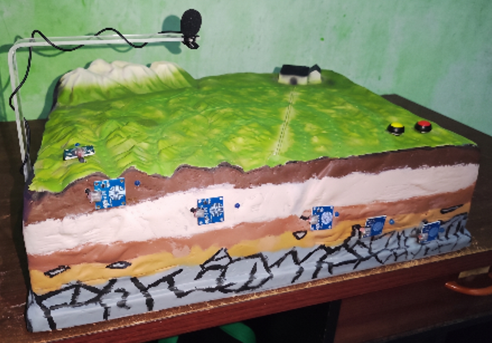
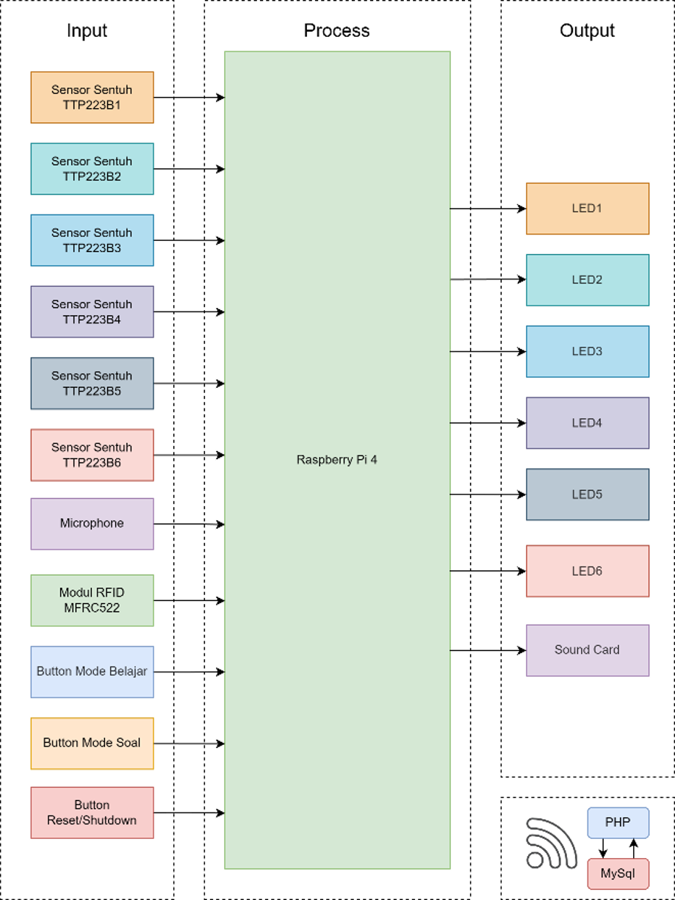
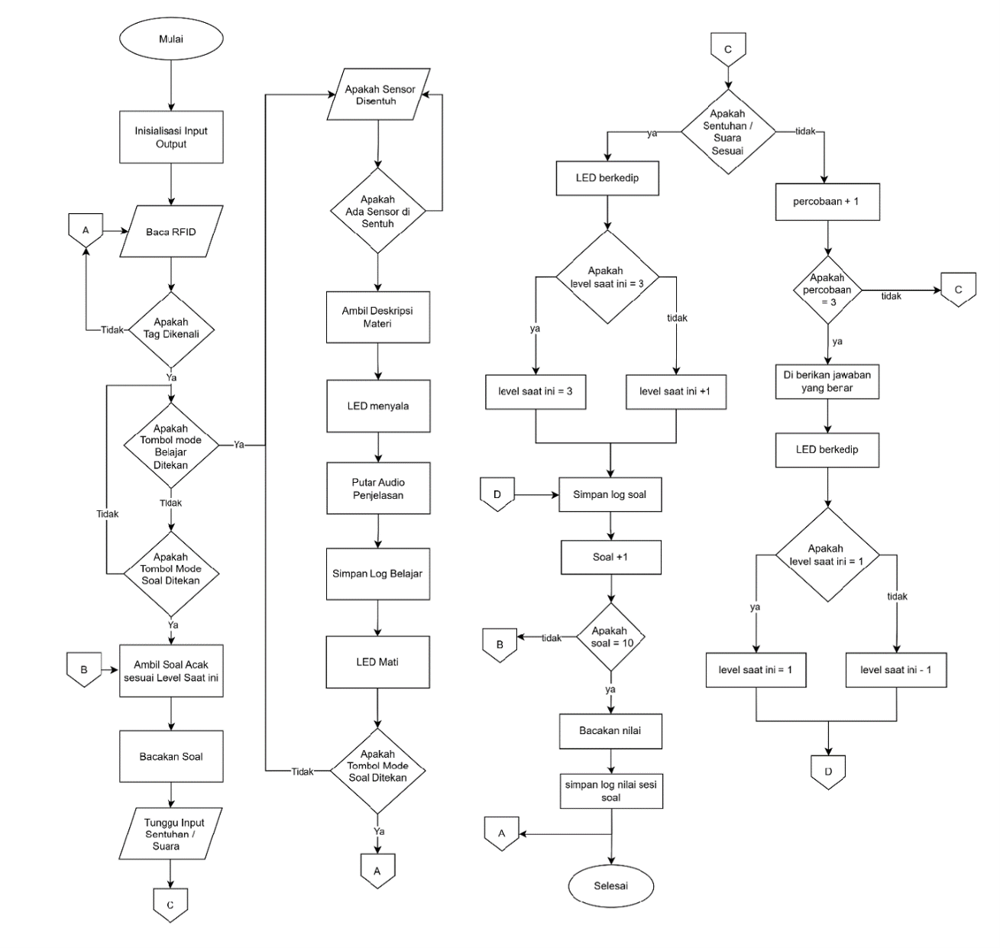

# Media Pembelajaran Lapisan Tanah dengan Algoritma Adaptive Learning (IoT)

Sistem media pembelajaran interaktif berbasis alat peraga fisik cerdas (**Raspberry Pi 4 Model B**) yang memadukan interaksi multisensorik (sensor sentuh kapasitif, RFID, LED indikator, mikrofon pengenal suara, dan *Text-to-Speech*) dengan algoritma **Dynamic Difficulty Adjustment (DDA)** serta panel manajemen web berbasis **PHP & MySQL** untuk pembelajaran Geografi tingkat SMA kelas X.

---

## Ringkasan & Hasil Pengujian Sistem

* **Dimensi Alat Peraga:** Maket penampang 6 horizon lapisan tanah (**O, A, E, B, C, R**) berukuran **47,5 cm (P) × 33,5 cm (L) × 16,5 cm (T)** lengkap dengan mikrofon kondensor, modul RFID, tombol mode, dan indikator LED di setiap lapisan.
* **Kinerja Perangkat Keras & Sinkronisasi:** Mencapai tingkat keberhasilan **100%** pada pembacaan 10 sampel kartu RFID MFRC522, respons tombol mode & daya (*debounce* reboot/shutdown), sensor sentuh TTP223B, serta transmisi data ke basis data MySQL (**0% packet loss**).
* **Evaluasi Algoritma DDA:** Terbukti akurat **100%** dalam menyesuaikan tingkat kesulitan soal (*Mudah*, *Sedang*, *Sulit*) secara *real-time* berdasarkan performa jawaban siswa dengan batas toleransi maksimal **3 kali percobaan** sebelum sistem membacakan kunci jawaban, menyalakan LED lapisan terkait, dan menurunkan level soal.
* **Penilaian Kelayakan Pengguna:** Memperoleh skor kelayakan kategori **Sangat Baik** sebesar **93,75%** dari guru Geografi, **89,50%** dari guru umum, dan **83,48%** dari siswa.

---

## Dokumentasi Alat & Arsitektur Sistem

### Prototipe Fisik Alat Peraga


### Diagram Blok & Alur Kerja (Flowchart)
| Diagram Blok Sistem | Flowchart Logika & DDA |
| :---: | :---: |
|  |  |

---

## Konfigurasi Pin GPIO Raspberry Pi 4 (Mode BCM)

| Komponen Hardware | Pin GPIO (BCM) | Keterangan Fungsi |
| :--- | :---: | :--- |
| **Sensor Sentuh TTP223B (Horizon O, A, E, B, C, R)** | `GPIO 5, 6, 12, 13, 16, 22` | Deteksi sentuhan pada masing-masing horizon tanah |
| **LED Indikator (Horizon O, A, E, B, C, R)** | `GPIO 23, 19, 20, 26, 21, 27` | Indikator visual lapisan aktif & petunjuk kunci jawaban |
| **Tombol Mode Belajar (Kuning)** | `GPIO 18` | Memilih mode eksplorasi mandiri |
| **Tombol Mode Soal (Merah)** | `GPIO 17` | Memilih mode kuis adaptif / interupsi pindah mode |
| **Tombol Daya / Reset** | `GPIO 24` | Tahan `1–4 detik` untuk *Reboot*, `≥ 5 detik` untuk *Shutdown* |
| **Modul RFID MFRC522** | Antarmuka `SPI` (`CE0`, `SCLK`, `MOSI`, `MISO`, `GPIO 25`) | Autentikasi kartu identitas siswa & registrasi kartu baru |
| **USB Soundcard & Mikrofon** | Port `USB` | Input suara jawaban kuis (*Google Speech Recognition*) & output *gTTS* |

---

## Struktur Repository

```text
media-pembelajaran-lapisan-tanah/
├── assets/
│   ├── audio/                    # Aset audio panduan, materi horizon & bank soal (.mp3)
│   ├── css/                      # Stylesheet antarmuka panel web
│   └── img/                      # Aset gambar antarmuka web
├── config/
│   └── koneksi.example.php       # Template koneksi database MySQL untuk PHP
├── docs/
│   ├── prototype.png             # Foto fisik prototipe alat peraga
│   ├── block-diagram.png         # Diagram blok input-proses-output
│   └── flowchart.png             # Diagram alir mode belajar & algoritma DDA
├── hardware/
│   ├── tools/                    # Utilitas pendukung perangkat keras
│   ├── config.example.py         # Template konfigurasi database & path Raspberry Pi
│   ├── requirements.txt          # Daftar pustaka Python
│   └── main.py                 # Program utama kontrol GPIO, RFID, TTS, STT & DDA
├── panel/                        # Dashboard CRUD Guru & Admin (soal, materi, siswa, log)
├── cek_login.php                 # Autentikasi sesi pengguna (RBAC Admin & Guru)
├── db_skripsi_tanah.sql          # Skema database MySQL, materi dasar & bank soal awal
├── index.php                     # Halaman utama & routing sesi
├── login.php                     # Halaman login panel web
├── logout.php                    # Penghapusan sesi login
├── .gitignore
└── README.md
```

---

## Panduan Instalasi & Konfigurasi Lokal

1. **Setup Database MySQL:**
   * Buat database baru bernama `db_skripsi_tanah` di phpMyAdmin atau MySQL CLI.
   * Impor file `db_skripsi_tanah.sql` (sudah mencakup skema tabel, 6 materi horizon tanah, 40 bank soal awal, serta akun *default* `admin` / `admin123` dan `guru` / `guru123`).
2. **Setup Panel Web (PHP):**
   * Salin `config/koneksi.example.php` menjadi `config/koneksi.php`, lalu sesuaikan `$username` dan `$password` database Anda.
3. **Setup Perangkat Keras (Raspberry Pi 4):**
   * Aktifkan antarmuka **SPI** melalui `sudo raspi-config`.
   * Salin `hardware/config.example.py` menjadi `hardware/config.py`, lalu sesuaikan kredensial `DB_CONFIG` dan `MIC_INDEX`.
   * Instal seluruh pustaka Python yang diperlukan:
     ```bash
     pip install -r hardware/requirements.txt
     ```
   * Jalankan program utama:
     ```bash
     python3 hardware/utama5.py
     ```